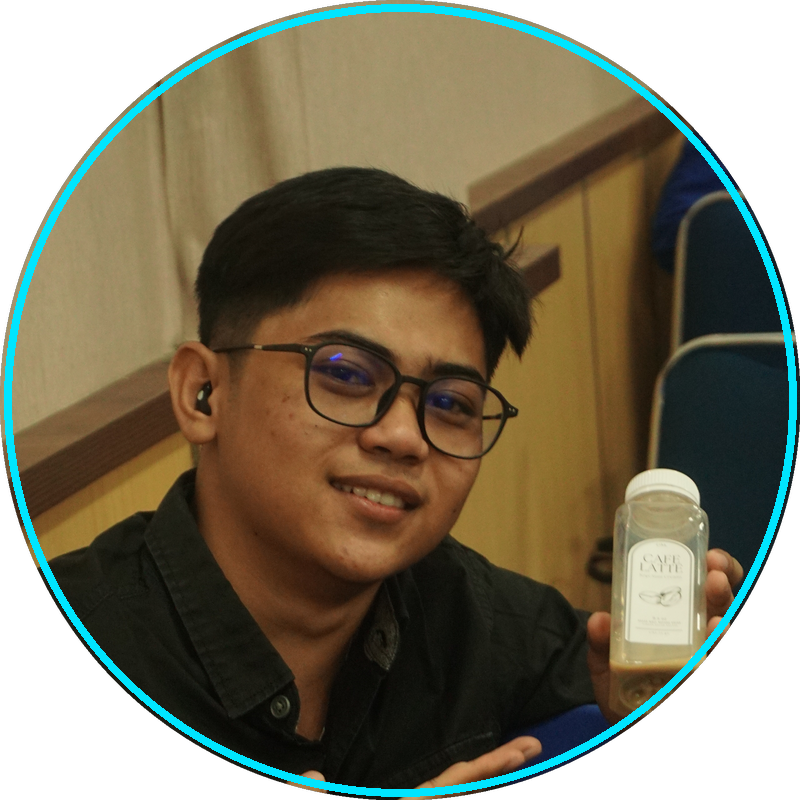

<div align="center">

  <!-- Header Banner -->

  <!-- Profile Avatar -->
  <br/>
  
  <br/><br/>

  <!-- Typing SVG Animation -->
  <a href="https://git.io/typing-svg">
    
  </a>

  <!-- Social Badges & Profile Views -->
  <p align="center">
    <a href="https://linkedin.com/in/rafli-maulana" target="_blank">
      
    </a>
    <a href="https://instagram.com/rflii_mlana" target="_blank">
      
    </a>
    <a href="mailto:raflimaulana13158@gmail.com">
      
    </a>
    <a href="https://github.com/Rafli0m?tab=followers">
      
    </a>
  </p>


</div>

---

### About Me

```yaml
name: Rafli Maulana
role: Data Scientist & Informatics Student
focus_areas:
  - Machine Learning & Deep Learning
  - Text Processing & Natural Language Processing (NLP)
  - Expert Systems & Decision Support Systems (DSS)
  - Data Analytics & Predictive Modeling
current_status: Exploring Advanced NLP & Intelligent Systems
location: Indonesia
```

- Mahasiswa **Informatika** (Semester 7) dengan fokus utama pada **Data Science** dan **Kecerdasan Buatan (AI)**.
- Berpengalaman mengembangkan sistem berbasis data seperti Sistem Pendukung Keputusan (PROMETHEE), Sistem Pakar (Certainty Factor & Fuzzy Logic), hingga NLP/Text Processing.
- Gemar menggabungkan backend development (*Python/Laravel*) dengan pipeline *Machine Learning* untuk menciptakan solusi cerdas yang berdampak.
- **Fun Fact:** Senang mengeksplorasi arsitektur sistem cerdas dan visualisasi data yang presisi.

---

### Tech Stack & Skills

<div align="center">

#### **Programming Languages**
<p>
  
  
  
  
  
</p>

#### **Data Science, AI & Machine Learning**
<p>
  
  
  
  
  
  
</p>

#### **Frameworks & Web Development**
<p>
  
  
  
  
</p>

#### **Tools & Environments**
<p>
  
  
  
  
</p>

</div>

---

### Featured Repositories

| Repository | Deskripsi | Tech Stack |
| :--- | :--- | :--- |
| **[text-processing](https://github.com/Rafli0m/text-processing)** | Praktikum Pemrosesan Teks (EDA, Preprocessing, Tokenisasi & Analisis Teks). | `Python`, `Jupyter`, `Pandas`, `NLP` |
| **[fuzzy_stres-level](https://github.com/Rafli0m/fuzzy_stres-level)** | Sistem pakar berbasis Fuzzy Logic untuk deteksi tingkat stres mahasiswa. | `Python`, `Fuzzy Logic`, `AI` |
| **[sistem-pakar-tht](https://github.com/Rafli0m)** | Sistem pakar diagnosis penyakit THT menerapkan algoritma Certainty Factor. | `Python`, `Certainty Factor`, `Flask` |

---

### GitHub Stats


<div align="center">
  
</div>

---

### Let's Connect

<div align="center">

[](https://linkedin.com/in/rafli-maulana)
[](https://instagram.com/rflii_mlana/)
[](mailto:raflimaulana13158@gmail.com)

</div>

<!-- LAST_UPDATED:START -->
<!-- Last Updated: Thursday, 29 October 2026, 17:26:57 WIB (UTC+7) -->
<!-- LAST_UPDATED:END -->

<p align="center">
  
</p>
